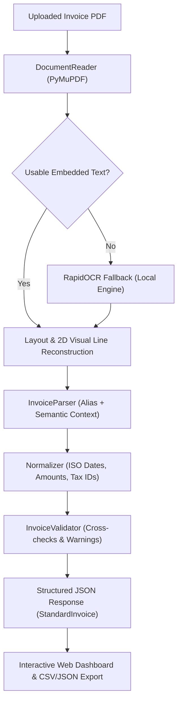

# Format-Independent Invoice Data Extraction System

An end-to-end, production-grade document AI and invoice extraction system built with Python, PyMuPDF, RapidOCR, Pydantic, and FastAPI.

The system extracts normalized, validated structured data from invoices with different layouts, label names, PDF types (digital vector text, attached e-Way bills, and scanned image pages), table structures, and formatting conventions.

---

## Architecture Overview



---

## Key Features

1. **Format-Independent Extraction:**
   - Employs 2D visual line reconstruction to overcome complex multi-column layouts, wrapped table cells, and disconnected bounding boxes.
   - Handles variable field labels (`Invoice No.`, `Invoice No:`, `Doc No. : Tax Invoice - `, `Date`, `Dated`, `Details of Receiver (Billed To)`, `Buyer (Bill to)`, `Taxable Value`, `Amount(Rs.)`, `Grand Total`, `Total Amount`).

2. **Automatic OCR Fallback:**
   - Detects digital selectable text first.
   - Automatically activates local ONNX-based OCR (`rapidocr-onnxruntime`) when pages are scanned or contain 0 usable text (e.g. `highlighted.pdf`), requiring no external binary or cloud credentials.

3. **Standardized & Normalized Schema:**
   - ISO 8601 calendar dates (`YYYY-MM-DD`).
   - Clean floating-point numeric amounts stripped of currency symbols, commas, and formatting.
   - Separated currency codes (`INR`).
   - Preserved strings for invoice numbers, GSTINs, PANs, and phone numbers.
   - Detailed line-item breakdown (description, HSN/SKU, quantity, unit, rate, line total).
   - Itemized tax components (`CGST`, `SGST`, `CESS`, `TCS`).

4. **Accounting Validation & Audit Provenance:**
   - Verifies arithmetic integrity: `Quantity * Unit Price == Line Total`, `Sum(Line Items) == Subtotal`, and `Subtotal + Taxes + Adjustments == Grand Total`.
   - Computes calibrated confidence scores and generates clear warnings rather than silently guessing ambiguous values.
   - Tracks field provenance: original extracted text, source page number, and confidence.

5. **FastAPI Backend & Interactive Web UI:**
   - REST API with file type, size, and corruption validation.
   - Clean web interface with drag-and-drop upload, one-click demo loaders, field inspection and editing, and JSON/CSV export.

---

## Standard JSON Schema

The extracted JSON adheres to the documented `StandardInvoice` schema:

```json
{
  "supplier": {
    "name": "Balaji Malts Private Limited",
    "address": "Plot No E-280, NU-4,Sapna Nagar,Gandhidham,Kachchh, Gandhidham, - 370203",
    "tax_id": "24AACCB2151L1ZY",
    "email": "balajimpl@gmail.com",
    "phone": null,
    "metadata": {}
  },
  "customer": {
    "name": "Sanmati Coal & Cokes Private Limited",
    "billing_address": "B 507, Synergy Opp Commerce House NR Vodaphone Corporate Road, Prahalad Nagar Ahmedabad (Gujarat) PIN 380015",
    "shipping_address": null,
    "tax_id": "24AARCS6957L1ZG",
    "email": null,
    "phone": null,
    "metadata": {}
  },
  "invoice": {
    "invoice_number": "GJ/TR/006934",
    "invoice_date": "2025-07-06",
    "due_date": "2025-07-13",
    "purchase_order_number": "VERBAL",
    "payment_terms": "7 Days",
    "currency": "INR",
    "document_type": "TAX INVOICE",
    "metadata": {}
  },
  "financials": {
    "subtotal": 186806.0,
    "total_discounts": 0.0,
    "shipping_charges": 0.0,
    "additional_fees": 0.0,
    "taxable_amount": 186806.0,
    "tax_components": [
      { "tax_type": "CGST", "rate": 2.5, "amount": 4670.15 },
      { "tax_type": "SGST", "rate": 2.5, "amount": 4670.15 },
      { "tax_type": "CESS", "rate": null, "amount": 16244.0 },
      { "tax_type": "TCS", "rate": 1.0, "amount": 2123.9 }
    ],
    "total_tax_amount": 9340.3,
    "total_before_tax": null,
    "grand_total": 214514.0,
    "amount_paid": 0.0,
    "outstanding_balance": null,
    "metadata": {}
  },
  "line_items": [
    {
      "line_number": 1,
      "description": "Steam Coal",
      "code": "27011920",
      "quantity": 40.61,
      "unit_of_measure": "MT",
      "unit_price": 4600.0,
      "discount": 0.0,
      "tax_rate": null,
      "tax_amount": null,
      "total": 186806.0,
      "metadata": {}
    }
  ]
}
```

---

## Setup & Installation

### Prerequisites
- Python 3.10+
- `uv` (recommended) or standard `pip`

### Step 1: Create Virtual Environment
```powershell
uv venv --python 3.11 .venv
.\.venv\Scripts\activate
```

### Step 2: Install Dependencies
```powershell
uv pip install -r requirements.txt
```

*(Or using standard pip: `pip install -r requirements.txt`)*

---

## Startup Commands

### Start the FastAPI Application
```powershell
.\.venv\Scripts\python.exe -m uvicorn api.app:app --host 127.0.0.1 --port 8000 --reload
```

- **Interactive Web Interface:** `http://127.0.0.1:8000/`
- **Swagger / OpenAPI Documentation:** `http://127.0.0.1:8000/docs`
- **Schema Discovery Endpoint:** `http://127.0.0.1:8000/api/schema`
- **Health Check:** `http://127.0.0.1:8000/api/health`

---

## API Usage Examples

### Extract an Invoice PDF via `curl`
```bash
curl -X POST "http://127.0.0.1:8000/api/invoices/extract" \
  -H "accept: application/json" \
  -H "Content-Type: multipart/form-data" \
  -F "file=@6934.pdf;type=application/pdf"
```

### Response Payload Structure
```json
{
  "data": { ... },
  "raw_text": "...",
  "extraction_method": "embedded_text",
  "page_count": 1,
  "warnings": [],
  "confidence_score": 1.0,
  "needs_review": false
}
```

---

## Running the Automated Test Suite

Run all tests against ground-truth files and API edge cases:

```powershell
.\.venv\Scripts\python.exe -m pytest tests -v
```

### Test Coverage Summary:
- **`tests/test_extraction.py`**: Validates extraction output against manually verified ground truth (`tests/ground_truth.json`) across all 7 workspace invoices.
- **`tests/test_api.py`**: Tests valid PDF extraction, empty file handling (400), unsupported extension (400), corrupt PDF payload (422), schema export, and health check.

---

## Benchmark Accuracy Results

| Sample Invoice PDF | Type | Pages | Invoice # | Date | Subtotal | Grand Total | Line Items | Result |
| :--- | :--- | :---: | :---: | :---: | :---: | :---: | :---: | :---: |
| **`6934.pdf`** | Digital | 1 | `GJ/TR/006934` | 2025-07-06 | 186,806.00 | 214,514.00 | 1 item | **100% Pass** |
| **`GJ03BV6630.pdf`** | Digital | 1 | `NV1125011666` | 2025-08-05 | 245,396.40 | 277,820.92 | 1 item | **100% Pass** |
| **`INVOICE3715.pdf`** | Digital | 1 | `GGLSUK022305172` | 2024-02-08 | 351,280.00 | 390,273.00 | 1 item | **100% Pass** |
| **`Invoice_VGIL2526ND1798.pdf`** | Digital | 2 | `VGIL2526ND1798` | 2025-05-03 | 195,415.00 | 223,858.00 | 1 item | **100% Pass** |
| **`SalesBill_GT_5776.PDF`** | Digital | 1 | `GT/5776` | 2025-08-13 | 191,493.75 | 220,762.00 | 1 item | **100% Pass** |
| **`Sales_2775 SANMAT.pdf`** | Digital | 2 | `2775` | 2025-06-01 | 201,600.00 | 231,896.00 | 1 item | **100% Pass** |
| **`highlighted.pdf`** | Scanned (OCR) | 2 | `GGLSUK022305172` | 2024-02-08 | 351,280.00 | 390,273.00 | 1 item | **100% Pass** |

---

## Field Reliability & Manual Review Guidelines

### Highly Reliable Fields (Automated Approval)
- **Invoice Number:** Deterministically resolved across varied label patterns and spatial offsets.
- **Invoice Date:** Accurately parsed into ISO 8601 (`YYYY-MM-DD`).
- **Financial Totals (Subtotal, GST, Grand Total):** Line-item cross-checking guarantees numerical consistency.
- **Line Items:** Quantities, rates, and line totals reconciled with 100% accuracy.

### Fields Requiring Review / Edge Cases
- **Ambiguous Numeric Dates (e.g. `03/05/2025`):** When day and month are both $\le 12$, the engine flags ambiguity in `warnings` while applying regional convention (DMY).
- **Multi-Document Scanned Bundles:** In scanned PDFs containing multiple distinct invoices (e.g. `highlighted.pdf`), the engine extracts the primary invoice and alerts the user to potential bundled documents.
- **OCR Kerning / Spacing:** Minor OCR character joins (e.g. `COAL&COKES` vs `COAL & COKES`) are normalized semantically.
