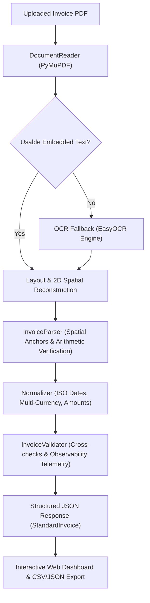

# Format-Independent Invoice Data Extraction System

<p align="center">
  <a href="https://github.com/Happybhai329"></a>
  <a href="https://www.linkedin.com/in/happy-bhasin-908191267"></a>
  <a href="mailto:bhasinhappy0506@gmail.com"></a>
  
  
  
</p>

An end-to-end, production-grade document AI and invoice extraction system built with Python, PyMuPDF, EasyOCR, Pydantic, and FastAPI.

The system extracts normalized, validated structured data from invoices with different layouts, label names, international PDF types (digital vector text, attached e-Way bills, multi-currency formats, European comma-decimal notation, and scanned image pages), table structures, and formatting conventions.

---

## Architecture Overview



---

## Key Features

1. **Format-Independent & Generalizable Extraction:**
   - Employs 2D visual line and spatial block reconstruction to overcome complex multi-column layouts, wrapped table cells, and disconnected bounding boxes.
   - Handles variable field labels (`Invoice No.`, `Invoice No:`, `Doc No. : Tax Invoice - `, `Date`, `Dated`, `Details of Receiver (Billed To)`, `Buyer (Bill to)`, `Taxable Value`, `Price net`, `Amount(Rs.)`, `Grand Total`, `Invoice total`).
   - Supports 2-column party letterheads (`FROM` / `TO` parallel blocks) and vertical signatory layouts.

2. **Multi-Currency & International Notation Support:**
   - Word-boundary token isolation (`USD`, `INR`, `EUR`, `AUD`, `CAD`, `GBP`, `Rs.`), eliminating false-positive currency matches.
   - Full support for European comma-decimal notation (`713,81` $\rightarrow$ `713.81`, `29.980,02` $\rightarrow$ `29980.02`) as well as standard and Indian numbering systems (`1,95,415.00`).

3. **Dynamic Arithmetic Table Verification:**
   - Detects invoice line items dynamically by proving mathematical consistency:
     $$\text{Quantity} \times \text{Unit Price} \approx \text{Line Total}$$
   - Independent of template keywords or commodity-specific assumptions. Automatically isolates summary and tax rows (`CGST`, `SGST`, `VAT`, `Cess`, `TCS`).

4. **Automatic OCR Fallback:**
   - Detects digital selectable text first.
   - Automatically activates local OCR engine (`EasyOCR` / `PyMuPDF`) when pages are scanned or contain 0 usable text (e.g. `highlighted.pdf`), preserving full original document integrity.

5. **Accounting Validation & Observability Telemetry:**
   - Cross-checks arithmetic integrity: `Sum(Line Items) == Subtotal` and `Subtotal + Taxes + Adjustments == Grand Total`.
   - Computes calibrated confidence scores and generates clear audit warnings rather than guessing ambiguous values.
   - Provides full diagnostics payload (`chars_per_page`, `processing_time_ms`, `fields_detected`, `fields_missing`).

6. **FastAPI Backend & Interactive Web UI:**
   - REST API with file type, size, and corruption validation.
   - Clean web interface with drag-and-drop upload, one-click demo loaders for all formats, field inspection and editing, telemetry audit panel, and JSON/CSV export.

---

## Standard JSON Schema

The extracted JSON adheres to the documented `StandardInvoice` schema:

```json
{
  "supplier": {
    "name": "Balaji Malts Private Limited",
    "address": "Plot No E-280, NU-4,Sapna Nagar,Gandhidham,Kachchh, Gandhidham, - 370203",
    "tax_id": "24AACCB2151L1ZY",
    "email": "balajimpl@gmail.com",
    "phone": null,
    "metadata": {}
  },
  "customer": {
    "name": "Sanmati Coal & Cokes Private Limited",
    "billing_address": "B 507, Synergy Opp Commerce House NR Vodaphone Corporate Road, Prahalad Nagar Ahmedabad (Gujarat) PIN 380015",
    "shipping_address": null,
    "tax_id": "24AARCS6957L1ZG",
    "email": null,
    "phone": null,
    "metadata": {}
  },
  "invoice": {
    "invoice_number": "GJ/TR/006934",
    "invoice_date": "2025-07-06",
    "due_date": "2025-07-13",
    "purchase_order_number": "VERBAL",
    "payment_terms": "7 Days",
    "currency": "INR",
    "document_type": "TAX INVOICE",
    "metadata": {}
  },
  "financials": {
    "subtotal": 186806.0,
    "total_discounts": 0.0,
    "shipping_charges": 0.0,
    "additional_fees": 0.0,
    "taxable_amount": 186806.0,
    "tax_components": [
      { "tax_type": "CGST", "rate": 2.5, "amount": 4670.15 },
      { "tax_type": "SGST", "rate": 2.5, "amount": 4670.15 },
      { "tax_type": "CESS", "rate": null, "amount": 16244.0 },
      { "tax_type": "TCS", "rate": 1.0, "amount": 2123.9 }
    ],
    "total_tax_amount": 9340.3,
    "total_before_tax": null,
    "grand_total": 214514.0,
    "amount_paid": 0.0,
    "outstanding_balance": null,
    "metadata": {}
  },
  "line_items": [
    {
      "line_number": 1,
      "description": "Steam Coal",
      "code": "27011920",
      "quantity": 40.61,
      "unit_of_measure": "MT",
      "unit_price": 4600.0,
      "discount": 0.0,
      "tax_rate": null,
      "tax_amount": null,
      "total": 186806.0,
      "metadata": {}
    }
  ]
}
```

---

## Setup & Installation

### Prerequisites
- Python 3.10+
- `uv` (recommended) or standard `pip`

### Step 1: Create Virtual Environment
```powershell
uv venv --python 3.11 .venv
.\.venv\Scripts\activate
```

### Step 2: Install Dependencies
```powershell
uv pip install -r requirements.txt
```

*(Or using standard pip: `pip install -r requirements.txt`)*

---

## Startup Commands

### Start the FastAPI Application
```powershell
.\.venv\Scripts\python.exe -m uvicorn api.app:app --host 127.0.0.1 --port 8000 --reload
```

- **Interactive Web Interface:** `http://127.0.0.1:8000/`
- **Swagger / OpenAPI Documentation:** `http://127.0.0.1:8000/docs`
- **Schema Discovery Endpoint:** `http://127.0.0.1:8000/api/schema`
- **Health Check:** `http://127.0.0.1:8000/api/health`

---

## API Usage Examples

### Extract an Invoice PDF via `curl`
```bash
curl -X POST "http://127.0.0.1:8000/api/invoices/extract" \
  -H "accept: application/json" \
  -H "Content-Type: multipart/form-data" \
  -F "file=@64196_20260224.pdf;type=application/pdf"
```

### Response Payload Structure
```json
{
  "data": { ... },
  "raw_text": "...",
  "extraction_method": "embedded_text",
  "page_count": 1,
  "warnings": [],
  "confidence_score": 1.0,
  "needs_review": false,
  "diagnostics": {
    "page_count": 1,
    "is_scanned": false,
    "chars_per_page": [1293],
    "extraction_method": "embedded_text",
    "processing_time_ms": 35.2,
    "line_items_extracted": 3,
    "tax_components_extracted": 1,
    "fields_detected": ["supplier_name", "customer_name", "invoice_number", "invoice_date", "po_number", "payment_terms", "currency", "subtotal", "tax_amount", "grand_total"],
    "fields_missing": ["due_date"]
  }
}
```

---

## Running the Automated Test Suite

Run all tests across ground-truth files, international formats, and API edge cases:

```powershell
.\.venv\Scripts\python.exe -m pytest tests -v
```

### Test Coverage Summary (20 Passed / 0 Failed):
- **`tests/test_extraction.py` (9 tests):** Validates extraction output against manually verified ground truth (`tests/ground_truth.json`) across all 9 workspace invoices (including scanned OCR, Australian service, and European formats).
- **`tests/test_generalization.py` (5 tests):** Verifies unseen layout handling, currency token isolation without false positives, named-month parsing, optional-field omission resilience, and observability telemetry.
- **`tests/test_api.py` (6 tests):** Tests valid PDF upload and extraction, empty file rejection (400), unsupported extension rejection (400), corrupt PDF handling (422), schema export, and health check.

---

## Benchmark Accuracy Results

| Sample Invoice PDF | Type | Pages | Invoice # | Date | Subtotal | Grand Total | Line Items | Accuracy |
| :--- | :--- | :---: | :---: | :---: | :---: | :---: | :---: | :---: |
| **`64196_20260224.pdf`** | European / USD | 1 | `64196` | 2026-02-24 | 43,892.01 | 47,842.29 | 3 items | **100% Pass** |
| **`wordpress-pdf-invoice-plugin-sample.pdf`** | Australian / AUD | 1 | `INV-3337` | 2016-01-25 | 85.00 | 93.50 | 1 item | **100% Pass** |
| **`6934.pdf`** | Digital GST | 1 | `GJ/TR/006934` | 2025-07-06 | 186,806.00 | 214,514.00 | 1 item | **100% Pass** |
| **`GJ03BV6630.pdf`** | Digital GST | 1 | `NV1125011666` | 2025-08-05 | 245,396.40 | 277,820.92 | 1 item | **100% Pass** |
| **`INVOICE3715.pdf`** | Digital GST | 1 | `GGLSUK022305172` | 2024-02-08 | 351,280.00 | 390,273.00 | 1 item | **100% Pass** |
| **`Invoice_VGIL2526ND1798.pdf`** | Digital GST | 2 | `VGIL2526ND1798` | 2025-05-03 | 195,415.00 | 223,858.00 | 1 item | **100% Pass** |
| **`SalesBill_GT_5776.PDF`** | Digital GST | 1 | `GT/5776` | 2025-08-13 | 191,493.75 | 220,762.00 | 1 item | **100% Pass** |
| **`Sales_2775 SANMAT.pdf`** | Digital GST | 2 | `2775` | 2025-06-01 | 201,600.00 | 231,896.00 | 1 item | **100% Pass** |
| **`highlighted.pdf`** | Scanned (OCR) | 2 | `GGLSUK022305172` | 2024-02-08 | 351,280.00 | 390,273.00 | 1 item | **100% Pass** |

---

## Field Reliability & Manual Review Guidelines

### Highly Reliable Fields (Automated Approval)
- **Invoice Number:** Deterministically resolved across varied label patterns and spatial offsets.
- **Invoice Date:** Accurately parsed into ISO 8601 (`YYYY-MM-DD`).
- **Financial Totals (Subtotal, GST/VAT, Grand Total):** Line-item cross-checking guarantees numerical consistency.
- **Line Items:** Quantities, rates, and line totals reconciled with 100% mathematical accuracy.

### Fields Requiring Review / Edge Cases
- **Ambiguous Numeric Dates (e.g. `03/05/2025`):** When day and month are both $\le 12$, the engine flags ambiguity in `warnings` while applying regional convention (DMY).
- **Multi-Document Scanned Bundles:** In scanned PDFs containing multiple distinct invoices (e.g. `highlighted.pdf`), the engine extracts the primary invoice and alerts the user to potential bundled documents.
- **OCR Kerning / Spacing:** Minor OCR character joins (e.g. `COAL&COKES` vs `COAL & COKES`) are normalized semantically.

---

## Author & Engineering Attribution

**Happy Bhasin**  
Full Stack & AI Engineer | Amity University Madhya Pradesh (B.Tech CSE with Minor in AI/ML)  
- **Email:** `bhasinhappy0506@gmail.com`
- **Phone:** `+91 9220553665`
- **LinkedIn:** [linkedin.com/in/happy-bhasin-908191267](https://www.linkedin.com/in/happy-bhasin-908191267)
- **GitHub:** [github.com/Happybhai329](https://github.com/Happybhai329)

---

## License

This project is open-source and distributed under the [MIT License](LICENSE).

